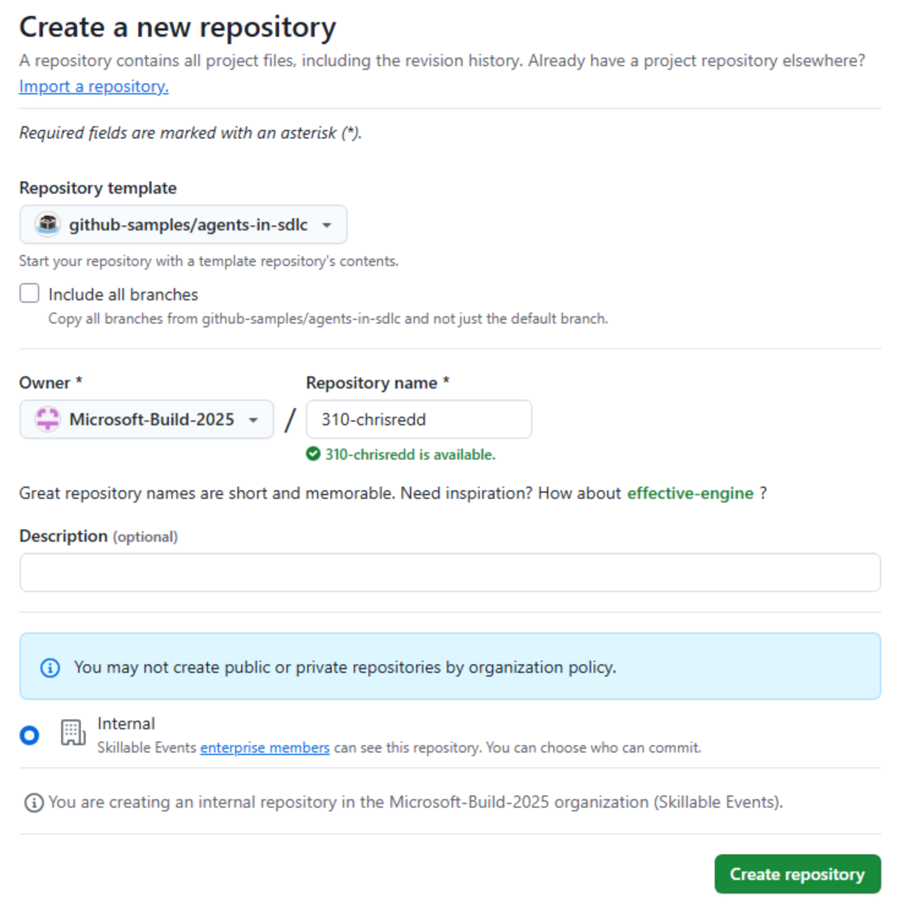

Antes de começar os exercícios do VS Code, você precisa preparar tudo. Você criará uma cópia própria do repositório Tailspin Toys, iniciará um [Codespace][codespaces] para trabalhar e confirmará que o GitHub Copilot Chat está funcionando no editor.

## Configure o repositório do laboratório

Para criar uma cópia do repositório para o código que você desenvolverá, crie uma instância a partir do [modelo][template-repository]. A nova instância conterá todos os arquivos necessários para o laboratório e será usada ao longo dos exercícios.

1. Em uma nova janela do navegador, acesse o [modelo da Tailspin Toys][tailspin-template].
2. Crie sua cópia do repositório selecionando o botão **Use this template** na página do repositório do laboratório. Em seguida, selecione **Create a new repository**.

    

3. Se você estiver participando de um evento conduzido pelo GitHub ou pela Microsoft, siga as instruções fornecidas pelas pessoas mentoras. Caso contrário, crie o novo repositório em uma organização na qual você tenha acesso ao GitHub Copilot.

    

4. Anote o caminho do repositório que você criou (**organization-or-user-name/repository-name**), pois precisará dele mais adiante no laboratório.

> [!NOTE]
> **Seu backlog está pronto**
>
> Ao criar o repositório com base no modelo, um backlog de issues do GitHub será criado automaticamente. Você trabalhará com essas issues durante o workshop — não é necessário criar nenhuma por conta própria.

## Crie um Codespace

Em seguida, você usará um Codespace para concluir os exercícios do laboratório.

[GitHub Codespaces][codespaces] é um ambiente de desenvolvimento na nuvem que permite escrever, executar e depurar código diretamente no navegador. Ele oferece um IDE completo com suporte a várias linguagens de programação, extensões e ferramentas.

1. Acesse o repositório que você acabou de criar.
2. Selecione o botão verde **Code**.

    

3. Selecione a guia **Codespaces** e, em seguida, selecione o botão **+** para criar um novo Codespace.

    

A criação do Codespace levará alguns minutos, embora ainda seja muito mais rápida do que instalar todos os serviços manualmente. Aproveite esse tempo para explorar outros recursos do GitHub Copilot, que veremos a seguir.

> [!CAUTION]
> Você voltará ao Codespace em um exercício futuro. Por enquanto, mantenha-o aberto em uma guia do navegador.

> [!NOTE]
> Este workshop foi criado para ser executado em um Codespace ou em um [contêiner de desenvolvimento][dev-containers] local. Ambos já incluem todos os pré-requisitos necessários para facilitar a experiência. Se preferir trabalhar localmente, abra o repositório clonado no VS Code e selecione **Reopen in Container** quando solicitado — o VS Code criará o mesmo contêiner de desenvolvimento usado pelo Codespace.

[codespaces]: https://github.com/features/codespaces
[dev-containers]: https://code.visualstudio.com/docs/devcontainers/containers

## Use o GitHub Copilot Chat e o modo de agente

Para acessar o modo de agente do GitHub Copilot Chat, você precisa ter a extensão GitHub Copilot Chat instalada no IDE. Ela já deverá estar instalada se você estiver usando um Codespace do GitHub.

> [!TIP]
> Se a extensão GitHub Copilot Chat não estiver instalada, você poderá [instalá-la pelo Visual Studio Code Marketplace][copilot-chat-extension]. Outra opção é abrir a exibição Extensions no Visual Studio Code, pesquisar **GitHub Copilot Chat** e selecionar **Install**.

Depois de instalar a extensão, talvez seja necessário autenticar sua conta do GitHub para habilitá-la.

1. Volte ao Codespace.
2. Se o Copilot Chat ainda não estiver à direita do editor, selecione o ícone **Copilot Chat** na parte superior do Codespace.
3. Digite uma mensagem, como "Hello world", na janela do Copilot Chat e pressione Enter. Isso deverá ativar o Copilot Chat.
4. Se você ainda não estiver autenticado, será solicitado que entre na sua conta do GitHub. Siga as instruções para autenticar.

    

5. Depois da autenticação, a janela do Copilot Chat deverá aparecer.

## Resumo

Parabéns! Você criou uma cópia do repositório do laboratório e começou a configurar o Codespace, que será usado ao trabalhar com o agente de nuvem do Copilot.

## Próxima etapa

Vamos adicionar instruções personalizadas que o agente de nuvem seguirá. Continue para [Exercício 1 - Instruções personalizadas][next-lesson], no qual você ensinará ao Copilot as convenções do projeto.

## Recursos

- [Visão geral do GitHub Codespaces][codespaces]
- [Criar um repositório a partir de um modelo][template-repository]
- [Primeiros passos com o Codespaces][codespaces-quickstart]

[tailspin-template]: https://github.com/github-samples/tailspin-toys
[template-repository]: https://docs.github.com/repositories/creating-and-managing-repositories/creating-a-template-repository
[codespaces-quickstart]: https://docs.github.com/codespaces/getting-started/quickstart
[copilot-chat-extension]: https://marketplace.visualstudio.com/items?itemName=GitHub.copilot-chat
[next-lesson]: ../1-custom-instructions/
